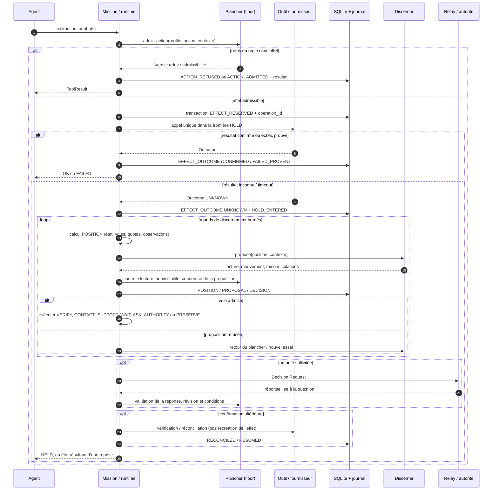

# HOLD — Architecture du runtime d’habilitation

**Audience :** architectes et ingénieurs d’entreprise  
**Référence analysée :** dépôt `/tmp/hold-review`, branche `main`, commit `d4ab8acf11f5cea409104753d195370a0769c156`.  
**Périmètre :** `hold/runtime.py`, `floor.py`, `profile.py`, `outcome.py`, `discern.py`, `hesitation.py`, `journal.py`, `store.py`, `replay.py`, `server.py`, `relay/*`, `studio/*`, `pyproject.toml` et tests associés.  

Ce document décrit le comportement observable de cette révision. Les mentions **Implémenté**, **Démontré par les tests** et **Non fourni / limite** séparent les mécanismes présents du niveau de preuve disponible. Un test qui passe démontre un scénario logiciel déterminé, pas une garantie universelle ni une qualification en production.

## 1. Synthèse d’architecture

HOLD est une bibliothèque Python qui place un **plancher de contrôle déterministe** entre les appels d’action d’un agent et les fonctions d’outils enregistrées par l’application. Des profils déclaratifs définissent les pouvoirs, limites et règles d’hésitation. Pour un effet externe à résultat incertain, le runtime enregistre l’incertitude et entre en HOLD : il recalcule les voies possibles, sollicite un « discerner » (règles de référence ou modèle), valide sa lecture et sa proposition, puis exécute seulement une voie admise ou conserve l’état. Les événements sont enregistrés dans SQLite et chaînés par empreinte. Sources : `hold/runtime.py:Habilitation`, `Mission.call`, `Mission._effect`, `Mission._hesitate`; `hold/floor.py:admit_action`, `admit_proposal`; `hold/hesitation.py:boundary_position`, `check_map`, `justified_moves`.

**À retenir :** le noyau peut refuser des appels non admissibles et empêcher, sous les conditions de son magasin partagé, une nouvelle distribution d’un effet déjà réservé. Il ne peut pas rendre vrai un résultat fournisseur inconnu, garantir la sémantique d’un système externe, ni transformer les décisions d’un modèle en jugement fiable. Les propres tests de garantie distinguent explicitement le périmètre de distribution HOLD, la déduplication fournisseur déclarée/vérifiée et le statut `UNKNOWN` (`tests/test_guarantees.py`).

## 2. Composants et responsabilités

- **Habilitation / Mission** (`runtime.py`) lie profil, magasin, outils, relais et discerner; ouvre ou reprend les missions; intercepte les appels; gère effets, attente, requêtes d’autorité, révocation et fermeture. Principaux symboles : `Habilitation.__init__`, `_register`, `binding`, `open_mission`, `mission`, `Mission.call`, `dispatch`, `hesitate`, `resume_pending`, `answer`, `revoke`, `close`. C’est implémenté. Le runtime peut être construit sans outils, notamment pour des opérations d’enregistrement; disponibilité des outils et validité du profil sont séparées (`runtime.py:Habilitation.missing_tools`, `server.py:resolve`).
- **Plancher** (`floor.py`) contrôle les appels selon identité/provenance, enveloppe, limites structurelles et mandat; il juge les propositions de discernement selon position, preuves et voies ouvertes. Symboles : `INVARIANTS`, `effect_key`, `envelope_violations`, `grant_problem`, `admit_action`, `admit_proposal`. Le plancher est un gardien de l’admissibilité, pas un planificateur général ni un exécuteur autonome.
- **Profils** (`profile.py`) : modèles Pydantic `Power`, `Authority`, `Hesitation`, `Profile`; validation de cohérence, chargement YAML/JSON, empreinte canonique, signature HMAC facultative et révision (`load_profile`, `dump_profile`, `sign`, `signature_valid`, `revise`). Le schéma décrit des paramètres d’autorisation; il n’atteste pas à lui seul l’identité réelle de l’autorité.
- **Hésitation et discernement** (`hesitation.py`, `discern.py`) : calcul déterministe de cohérence et de voies, validation de carte/proposition, discernement de référence ou appel à Llama/Ollama (`boundary_position`, `reference_path`, `check_map`, `justified_moves`, `ReferenceDiscerner`, `LlamaDiscerner`). Le modèle ne reçoit pas le choix de référence dans `model_view`; sa sortie reste non fiable et doit franchir le plancher.
- **Résultats d’outil** (`outcome.py`) normalise la réponse d’un outil en `Outcome` et expose un `ToolResult` à l’agent. `Outcome` distingue notamment succès, échec prouvé ou valeur; `ToolResult.for_model` précise états et suites. `HELD` signifie qu’un effet peut déjà exister et qu’il ne faut pas le répéter. `REFUSED` ne veut pas toujours dire qu’une correction est possible : cela dépend de `correctable` et de la règle.
- **Journal et stockage** (`journal.py`, `store.py`) : enveloppe versionnée, validation de champs, chaîne SHA-256 et persistance SQLite transactionnelle des missions, profils, événements, effets, quotas, demandes, attentes, grants et messages du relais. La chaîne peut détecter des altérations non recalculées; elle n’est ni une signature externe ni un ancrage immuable.
- **Rejeu** (`replay.py`) reconstitue l’état depuis les événements, vérifie positions et verdicts, compare les projections du magasin et exporte le journal (`Fold`, `verify_decisions`, `state_replay`, `decision_replay`, `export_journal`). Ce sont des contrôles de cohérence à partir des données présentes, pas une preuve formelle du modèle du monde ou de l’exécution fournisseur.
- **Relais** (`relay/base.py`, `relay/whatsapp.py`) définit le contrat `Relay`, les relais console/simulé, et l’intégration WhatsApp Cloud API avec messages interactifs ou modèles, webhook signé et traitement des réponses. Le mode simulé ne transmet rien (`SimulatedRelay`, `WhatsAppRelay`); le mode Cloud dépend d’une configuration et d’une intégration Meta opérationnelle.
- **Serveur / Studio** (`server.py`, `studio/core.js`, `studio/studio.src.html`) expose une API FastAPI pour santé, catalogue, validation de profil, lecture de missions, réponse, simulation de tap et webhook. L’interface permet personnalisation et consultation du journal; le JavaScript reprend la logique pure côté navigateur. L’accès Studio applique un garde loopback ou jeton, qui ne constitue pas à lui seul une architecture d’exposition publique complète.

## 3. Modèle de profil et de mandat

`Profile` (schéma `habilitation/v1`) porte un identifiant, titre, révision, dates, autorité, pouvoirs, règles d’hésitation et signature facultative (`profile.py:Profile`, env. lignes 179–231). Son empreinte SHA-256 est calculée sur la représentation canonique du profil sans la signature (`Profile.body`, `Profile.fingerprint`; `canonical.py`). `revise` crée une nouvelle révision; l’adoption d’un profil différent par une mission doit être explicite dans `Habilitation.mission(..., adopt=True)` (`runtime.py`, `tests/test_authority_binding.py`).

Les catégories de pouvoir sont `read`, `status`, `contact` et `effect` (`profile.py:Power`; les enregistrements correspondants sont `Habilitation.read/effect/status/contact`). Un effet doit déclarer une identité; seuls les effets portent enveloppe, identité et réconciliation (`Power._coherent`). L’identité contribue à la clé d’effet, qui associe mission, action et attributs d’identité (`floor.py:effect_key`). L’enveloppe peut spécifier champs requis, maximum monétaire, valeurs autorisées et fenêtres temporelles (`EffectEnvelope`, `envelope_violations`). Les attributs issus d’actions antérieures peuvent être soumis à des règles de provenance (`Power` et helpers de provenance de `floor.py`). Les effets dépendants sont déclarés par `depends_on`; les dépendances et actions de réconciliation sont validées au niveau du profil (`Profile._references`).

`Authority` définit le canal console/WhatsApp, coordonnées, seuil `sigma`, capacité de révocation, plafonds de demandes et contrôles supplémentaires, TTL des questions et grants (`profile.py:Authority`). `Hesitation` configure `tau_star`, l’ordre des voies, le traitement d’une proposition refusée, reprise autonome, nombre de rounds, politique de dépassement d’enveloppe, retries de carte et bornes d’attente (`profile.py:Hesitation`). La validation impose notamment `PRESERVE` comme dernière voie (`Hesitation._ladder`). Ces paramètres sont des limites logicielles; ils ne prouvent pas que la personne configurée est habilitée juridiquement.

Les profils exemples dans `hold/profiles/` illustrent réservation de voyage, remboursement et achat fournisseur : pouvoirs de lecture, effet, statut, contact de support, budgets et enveloppes différentes. Ce sont des exemples de configuration, non des validations d’un système métier connecté.

### Signature et identité

**Implémenté :** `sign`/`signature_valid` fournissent une signature HMAC-SHA256 optionnelle (`profile.py:sign`, `signature_valid`); `load_profile` peut exiger une signature via `require_signature`. **Non fourni :** gestion de clés, identité forte, révocation/rotation d’une PKI ou preuve de délégation juridique ne découlent pas de ces fonctions. Un profil signé avec un secret partagé authentifie au mieux la possession de ce secret dans le contexte d’exploitation concerné.

## 4. Séquence d’une action

Références : `runtime.py:Mission.call` → `_simple`/`_effect`; `Mission._effect` réserve et distribue; `Outcome.from_value`/types de résultat dans `outcome.py`; `Mission._record_effect`, `_position`, `_hesitate`, `_run_path`, `_resumed`; `floor.py:admit_action` et `admit_proposal`; `hesitation.py:boundary_position`; `runtime.py:Mission._open_request`, `answer`, `resume_pending`. Les transitions exactes dépendent du profil, de la disponibilité des voies, des outils enregistrés, des preuves reçues et du résultat de l’appel.

### Réservation et incertitude d’effet

Le runtime ne traite pas un timeout comme un échec prouvé : un résultat non établi reste `UNKNOWN`, et le statut exposé est `HELD` (`outcome.py:Outcome`, `ToolResult.for_model`; `runtime.py:Mission._held_message`). Les effets sont enregistrés avec clé, `operation_id`, état, attributs et compteurs dans la table `effects` (`store.py:SCHEMA`). La réservation en base précède l’appel externe dans la logique d’effet (`runtime.py:Mission._effect`). La stratégie de réconciliation s’appuie sur une action `status` du profil et des contrôles bornés; elle ne relance pas automatiquement l’effet initial.

**Démontré par les tests :** `tests/test_guarantees.py` vérifie qu’avec plusieurs threads/processus partageant le même magasin, un scénario distribue une fois; que deux magasins distincts ne coordonnent pas; que le fournisseur n’est considéré idempotent que si cela est déclaré/vérifié; et qu’un résultat indéterminé demeure `UNKNOWN`, avec fermeture `CLOSED_UNCONFIRMED` possible. `tests/test_runtime.py` et `tests/test_authority_binding.py` couvrent en outre l’état `HELD`, réconciliation et reprise sur scénarios synthétiques.

**Limites :** « au plus une distribution dans la frontière » s’applique à la frontière logicielle et au magasin partagé du scénario, non à plusieurs magasins/runtimes indépendants. La preuve de déduplication côté fournisseur est distinctement `DECLARED`, `VERIFIED` ou absente (`effect_guarantees`, `tests/test_guarantees.py`). Si le fournisseur a agi mais que la réponse se perd, HOLD ne peut pas inférer cet état sans preuve de réconciliation. Le format `operation_id` ne force pas le fournisseur à le respecter.

## 5. État, transitions et gestion des erreurs

### États exposés

Les statuts de résultat pour l’agent sont `OK`, `REFUSED`, `HELD`, `ALREADY_CONFIRMED`, `FAILED`, `CLOSED`, `REVOKED` (`outcome.py:ResultStatus`). Le statut d’une mission est persisté dans `missions` et inclus dans les événements; parmi les états visibles figurent `OPEN`, `HELD`, `AWAITING_AUTHORITY`, `REVOKED` et les fermetures `CLOSED_*` (`store.py:SCHEMA`, `runtime.py:Mission._close`, `wait`; `studio.src.html` pour le rendu). Les effets ont leurs propres statuts et ne doivent pas être confondus avec celui de mission.

`hesitation.py:coherence_of` attribue cohérence 1 aux effets `CONFIRMED` ou `FAILED_PROVEN`, et 0 sinon. La position détermine `tau_star`, les voies ouvertes, leur seuil de restauration `sigma`, l’autorité mobilisée, les ressources restantes et le caractère dirigé. `VERIFY` tient compte du nombre de contrôles et de `not_found` (décroissance `sigma * decay**not_found`); `CONTACT_SUPPORT` dépend de son budget; `ASK_AUTHORITY` dépend du canal, des demandes restantes et de l’absence d’une question déjà ouverte; `WAIT` requiert de la patience configurée et une condition pendante, tandis que `PRESERVE` conserve l’état sans agir (`hesitation.py:boundary_position`).

### Refus d’action et de proposition

Le plancher vérifie les actions à partir du profil et du contexte (`floor.py:admit_action`). Les motifs comprennent notamment les limites de l’enveloppe, les arguments, les dépendances et l’absence de provenance adéquate; le code qualifie certaines règles comme corrigeables (`CORRECTABLE` dans `floor.py`; `ToolResult.correctable` dans `outcome.py`). Le refus est un refus d’exécuter, pas nécessairement une faute fournisseur.

Pour une proposition de discernement, `check_map` confronte état d’effet et listes de voies à la position calculée; les citations de conditions pendantes doivent renvoyer à une observation existante et contenir une citation normalisée suffisamment longue. Une carte exacte mais comportant une condition pendante étayée peut être **UNDETERMINED**; une carte contradictoire est refusée. `justified_moves` décrit les mouvements justifiés selon cette lecture; `admit_proposal` applique ensuite les limites d’admissibilité, portée d’une lecture indéterminée et cohérence (`hesitation.py`, `floor.py`). Une directive valide de l’autorité peut primer sur la stratégie, mais reste soumise au périmètre, aux limites et aux conditions vérifiées dans le plancher (`tests/test_authority_binding.py`).

`ToolResult.for_model` distingue aussi les suites : refus corrigeable, action dépendant d’une action antérieure non encore confirmée, refus non réessayable, ou HOLD où un effet peut exister et ne doit pas être répété (`outcome.py:ToolResult.for_model`). Ces textes sont des consignes adressées à l’agent; ils ne garantissent pas son obéissance.

### Attente, demandes et révocation

L’attente est bornée par durée et nombre de pauses du profil. Le discernement ne peut justifier `WAIT` qu’avec une condition pendante citée dans les observations (`hesitation.py:check_map`, `justified_moves`). Demandes d’autorité et grants ont une question, un TTL, une liaison au profil/conditions, et une utilisation limitée (`runtime.py:Mission._open_request`, `_request_problem`, `answer`, `_close_request`; `profile.py:Authority`). Une approbation ponctuelle expirée, liée à une révision différente ou rendue caduque par un changement de conditions n’est pas valable dans les scénarios couverts (`tests/test_authority_binding.py`). Une révocation bloque la suite des actions et peut être déclenchée via la réponse `STOP` de l’autorité dans le traitement WhatsApp (`relay/whatsapp.py:Inbound._text`).

**Non fourni / limites de modèle d’état :** le mécanisme de temporisation appelle `sweep`/reprise lorsqu’il est invoqué; il ne faut pas supposer une exécution permanente du processus de fond sans configuration adéquate (`runtime.py:Habilitation._spawn`, `Mission.sweep`; l’initialisation détermine `background`). La fermeture administrative `CLOSED_UNCONFIRMED` ne transforme pas `UNKNOWN` en succès ou échec. Les observations textuelles et l’interprétation d’un état externe dépendent de sources hors HOLD.

## 6. Profils de discernement et décision

`Discerner` est un protocole avec `name` et `propose(position, context)` (`discern.py:Discerner`).

- **`ReferenceDiscerner`** : copie la voie de référence calculée par le noyau et utilise `true_map`; c’est une cascade de règles, non un modèle. Sa lecture est exacte par construction sur les champs que le noyau contrôle et il ne lit pas les textes libres (`discern.py:ReferenceDiscerner`).
- **`LlamaDiscerner`** : appelle Ollama local par HTTP, défaut `llama3.2:3b`; température 0, seed 42, contexte et prédiction bornés, sortie contrainte par schéma JSON (`discern.py:LlamaDiscerner`, `SYSTEM_PROMPT`, `OUTPUT_SCHEMA`). Disponibilité et digest du modèle sont recherchés par `/api/tags`. Les erreurs d’appel, de JSON ou de schéma donnent une proposition en erreur; les métadonnées conservent modèle, empreintes d’entrée/sortie et durée quand disponibles.
- **Autre implémentation** : possible via le protocole, par exemple dans les tests avec `Fixed`, `Reader` et discerners déterministes (`tests/test_discernment.py`, `test_studio_parity.py`). Cela ne signifie pas qu’un connecteur à un fournisseur de modèles distant particulier soit livré ici.

Le modèle reçoit les faits et la frontière sans la décision de référence (`discern.py:model_view`). Le runtime vérifie séparément (1) la lecture, (2) l’ouverture de la voie et (3) le fait que la voie découle de la lecture. Après les retries configurés, le profil peut appliquer la référence ou préserver (`hesitation.py` docstring et `profile.py:Hesitation.map_retries`, `on_refused_proposal`). Plusieurs choix peuvent être valables à partir des mêmes faits : le test ne mesure pas une conformité à un choix de référence comme unique stratégie (`hesitation.py:justified_moves`). La justification en texte libre est conservée; elle n’est pas prouvée sémantiquement par la vérification de carte.

**Démontré par les tests :** `tests/test_discernment.py` couvre propositions fixes, lectures erronées, attente appuyée ou non par citation, stratégie alternative admissible, refus d’une voie fermée et retombée sur la référence. `tests/test_studio_parity.py` génère des journaux de plusieurs scénarios synthétiques. **Non démontré :** performance générale du modèle, robustesse à l’adversarial, exactitude factuelle sur des systèmes réels, qualité décisionnelle à l’échelle ou bénéfice opérationnel.

## 7. Journal, stockage et rejeu

`journal.py:Event` décrit une enveloppe `hold.event/v1` avec mission, séquence, timestamp, type, acteur, cause, fingerprint/révision de profil, version du noyau, données, phase, statut après événement, hash précédent et hash courant. `make_event` valide acteur, phase et champs requis; `compute_hash` calcule SHA-256 sur les données canoniques sans champ `hash`. `verify_chain` vérifie version, séquence contiguë, chaînage, empreintes, type/champs et phases (`journal.py:verify_chain`).

`Store` utilise SQLite, transactions `BEGIN IMMEDIATE`, WAL hors mémoire, verrou local réentrant; les événements et l’état du magasin sont mis à jour dans la transaction (`store.py:Store.__init__`, `tx`, `append`). Le schéma sépare missions, profils, événements, effets, compteurs d’usage, requêtes, attentes, grants et messages relay (`store.py:SCHEMA`).

Le rejeu reconstruit un état logique (`Fold`), compare la projection actuelle du magasin (`state_replay`) et vérifie les positions puis verdicts de décision par recalcul (`verify_decisions`; `decision_replay`). `export_journal` regroupe événements, profils et projection pour analyse hors ligne (`replay.py`). Le Studio a sa propre implémentation JavaScript de la canonicalisation, empreinte, validation de chaîne et logique de décision (`studio/core.js`); `test_studio_parity.py` compare Python et JavaScript sur les journaux générés.

**Démontré par les tests :** les vérifications de chaîne, état et décision concordent pour les cas de test; les altérations de journal et certaines décisions/positions falsifiées sont repérées, y compris dans des cas où le hash chain est recalculé (`tests/test_runtime.py`, `tests/test_studio_parity.py`, `tests/test_relay_server.py`). La commande exécutée sur cette révision donne **160 tests réussis** (`pytest -q`, 21,13 s).

**Limites :** une chaîne de hash n’est pas immuable par elle-même : un acteur ayant accès à l’intégralité du magasin peut modifier les données et recalculer les hashes. Elle n’est pas ancrée par signature externe, stockage WORM ou tiers indépendant dans le périmètre décrit. Les tests de rejeu confirment cohérence par rapport au code et aux profils accessibles; ils ne prouvent ni vérité externe, ni intégrité de la machine/compte hébergeant SQLite, ni exhaustivité face à toutes les entrées possibles.

## 8. Interfaces et intégrations

### API et Studio

`server.py:create_app` crée l’application FastAPI. Routes observées : `/api/health`, validation/lecture du catalogue, `/api/profiles/validate`, `/api/missions`, détail mission, réponse à une question et simulation de tap. Les endpoints de mission appliquent `studio_guard` : loopback sans en-tête de transfert, ou jeton Bearer configuré (`HOLD_STUDIO_TOKEN`). Le webhook WhatsApp est séparé : GET de vérification par token; POST vérifie `X-Hub-Signature-256` avant décodage JSON (`server.py:wa_verify`, `wa_event`).

`studio.src.html` contient l’interface navigateur, personnalisateur de profils et visualisation de journaux; le Studio peut charger un profil ou journal JSON, comparer fingerprints, et afficher les résultats de vérification. La lecture périodique de mission et le traitement d’événements sont dans les symboles `threadHTML`, `computeChecks`, `loadMission`, `refreshRead` du fichier HTML. **À noter :** `server.py` cherche `studio/index.html`; le dépôt examiné contient `studio/studio.src.html` et `studio/core.js`. Le packaging inclut `studio/*` via `pyproject.toml`, mais aucune conclusion de déploiement sur l’existence ou génération d’un `index.html` ne doit être supposée à partir du seul serveur.

La garde locale protège les routes Studio contre les requêtes distantes selon les attributs observés; le jeton peut autoriser l’accès hors boucle locale. Elle n’est pas une substitution documentée à une architecture d’identité, d’autorisation multi-utilisateur, TLS, secrets et durcissement réseau adaptée à une exposition entreprise.

### Relais WhatsApp

`WhatsAppRelay` choisit le mode simulé si explicitement demandé ou si les éléments nécessaires à l’envoi manquent (`WhatsAppRelay.__init__`). Le mode cloud envoie les messages Graph API; la requête interactive se replie sur un template lors du code de fenêtre 24 h 131047 si un template est configuré (`send_request`). Le webhook entrant est parsé défensivement; signature HMAC, association mission/question/bouton, comparaison du numéro d’expéditeur avec le contact de l’autorité et idempotence du message sont dans `verify_signature`, `parse_webhook`, `Inbound._reply`, `Inbound._seen`. La réponse passe ensuite par `Mission.answer`, la porte commune aux réponses console et WhatsApp (`relay/base.py`, `server.py`, `relay/whatsapp.py`). Le mot de révocation est traité dans `_text` uniquement pour les missions actives et les profils autorisant la révocation.

**Démontré par les tests :** signature valide/invalide, formats de boutons, refus d’un tiers, déduplication de message, absence de question valide, révocation `STOP` et fallback template sont testés avec client/transport simulé (`tests/test_relay_server.py`). **Non fourni par ces tests :** validation de bout en bout avec un compte Meta réel, conformité de configuration de production, disponibilité du canal ou livraison effective d’un message.

### API d’outils et dépendances Python

Le paquet exige Python ≥3.10; dépendances de base : Pydantic 2, PyYAML, HTTPX; extras serveur : FastAPI/Uvicorn; extra dev : pytest. La commande console est `hold = hold.cli:entry` (`pyproject.toml`). Le runtime enregistre les fonctions d’outil via des décorateurs et peut déduire un schéma de signature (`runtime.py:Habilitation._register`, `_schema_from_signature`). Ces fonctions sont appelées dans le processus et n’acquièrent pas automatiquement transactions distribuées, isolation d’exécution, réseau de fournisseurs ou gestion des secrets.

## 9. Invariants architecturaux à préserver

1. **Contrôle avant appel :** un appel d’action est confronté au profil et au contexte avant exécution (`floor.py:admit_action`, `runtime.py:Mission.call`).
2. **Pas de répétition sur résultat inconnu :** `HELD` avertit qu’un effet existe peut-être; ne pas confondre absence de réponse et absence d’effet (`outcome.py:ToolResult.for_model`, `tests/test_guarantees.py`).
3. **Séparer admissibilité et déduplication fournisseur :** la réservation HOLD ne prouve pas l’idempotence externe; les garanties de fournisseur sont qualifiées séparément (`runtime.py:effect_guarantees`, `test_guarantees.py`).
4. **Le modèle propose, le plancher dispose :** carte, voie ouverte et cohérence sont contrôlées indépendamment (`hesitation.py`, `floor.py:admit_proposal`).
5. **Preuve d’attente :** `WAIT` doit être lié à une observation textuelle citée, dans les bornes du profil; la citation existante n’est pas une vérification sémantique que l’événement annoncé arrivera (`hesitation.py:check_map`, `boundary_position`).
6. **Pouvoir borné et révocable :** enveloppes, dépendances, quotas, TTL, portée/révision des grants et révocation restent des contrôles de runtime; une autorisation ne neutralise pas les invariants structurels (`floor.py:grant_problem`, `runtime.py:Mission.answer`, `tests/test_authority_binding.py`).
7. **Traçabilité vérifiable, non infaillibilité :** les événements ont un format contraint et chaîné; la vérification et le rejeu doivent détecter les incohérences, tout en reconnaissant qu’un stockage compromis peut être réécrit avec recalcul de chaîne (`journal.py`, `replay.py`, `tests/test_studio_parity.py`).
8. **Crédit du discernement séparé du fallback :** une décision autorisée alternative ne doit pas être déclarée incorrecte par seule différence à la référence; une décision appliquée par le noyau après refus est attribuée au plancher (`hesitation.py` docstring; événements `DECISION` dans `runtime.py`).

## 10. Frontières explicites : ce que ce dépôt ne fournit pas

- Pas de garantie que l’agent suive `ToolResult.for_model`, n’invente pas des affirmations, ou choisisse la meilleure stratégie.
- Pas de preuve que les outils/fournisseurs soient exacts, idempotents ou cohérents; ni de transaction atomique commune à SQLite et un service distant.
- Pas de coordination entre bases distinctes, ni de protocole consensus multi-région.
- Pas d’ancrage externe inviolable du journal, ni de signature indépendante des événements.
- Pas de vérification automatique de l’identité, du pouvoir juridique ou du consentement réel de l’autorité au-delà des liaisons techniques implantées.
- Pas de preuve formelle de correction/exhaustivité, certification, conformité réglementaire, test de charge, red team indépendante ou validation de production dans les fichiers/tests examinés.
- Pas de sémantique générale des observations libres : HOLD peut contrôler une référence de texte à une observation et certains champs structurés; il ne valide pas la vérité que rapporte l’observation.

Ces limites ne sont pas des conclusions contre l’utilité du mécanisme : elles définissent les propriétés que l’architecture met effectivement sous contrôle, celles qui restent dépendantes du système environnant, et les affirmations qui exigeraient des preuves supplémentaires.
